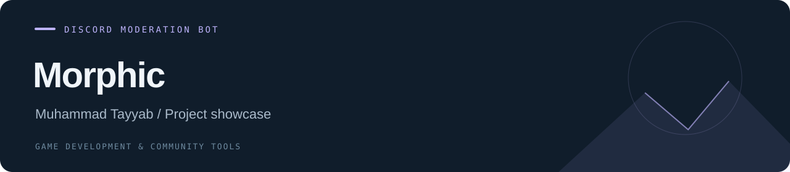

# Morphic

**Discord Moderation Bot · Project showcase**

A Discord moderation bot project for online communities.

| Project | Details |
| --- | --- |
| Developer | Muhammad Tayyab |
| Progress | Project showcase |
| Tools / focus | Discord · Community moderation |
| Repository contents | Project documentation and repository configuration |

## Project focus

- Discord moderation and community tooling.
- A separate project from the wider community manager.

## Repository status

This repository is a public project overview. Bot source code and configuration have not been uploaded.

## Media

See the [media guide](./media/README.md) for the project captures to add.

---

[All projects](https://github.com/tabi-malikx) · [Project catalogue](https://github.com/tabi-malikx/tabi-malikx#selected-projects)
